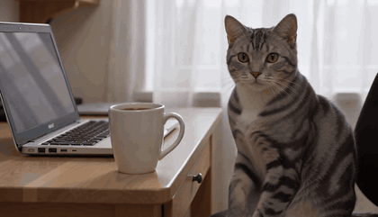

# side-quests

Detours I took when something kept breaking my flow. Each one fixed it. Help yourself.

| Item | What it does |
|---|---|
| [jargon-less-mode](jargon-less-mode/) | Every reply ends with just the TL;DR you need: what to decide, what could break, what nobody checked. |
| [work-timer](work-timer/) | Pings you when Claude has worked 10 minutes with nothing to show you, and nudges Claude to show you something. |

Click an item for what it does and how to set it up.

Each item credits what it is built on. Licence: MIT (see `LICENSE`), unless an item says otherwise.
