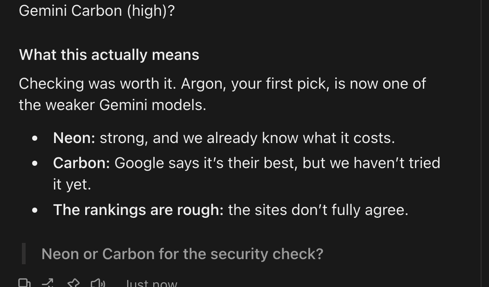

# jargon-less-mode

I'm a designer. I use Claude all the time, to build stuff that helps me work and to prototype my ideas.

Problem is, I just can't with the long, unclear verbiage Claude throws at me in every answer.

My unscientific theory: I was born in the Soviet Union, where they played fast and loose with the drugs in the
delivery room. Which gave me the undiagnosed neurospiciness that lets me play six-dimensional chess with the ideas
in my head, and leaves me zero ability to follow Claude's thought process when it asks me stuff.

I don't have time for this. It breaks my flow.

So I set up a default mode that gives me the TL;DR. Claude still writes its real answer, every technical word in
place. Then come a few lines in plain words: what I need to decide, what could break, what nobody has checked yet.

The plain part always sits in the same place, under the same title, so I find it without looking. I read that part.
I keep the real one to check nothing got lost.



*A real one, from the chat where I set up this page.*

## The rules for the second part

- **No lying, not even nicely.** "Very likely" never becomes "is". A risk still sounds like a risk.
- **It never knows more than the first part.** Every claim in the short part is in the long part above it.
- **Always shorter.** A translation, not a remix.
- **No walls of text.** Three or more points become bullets. The one question goes last, on its own line.

## What's in the box

| Part | File | What it does |
|---|---|---|
| **The skill** | `skill/technical-jargon-translator/SKILL.md` | The full rules, with examples. Loaded when you type `/technical-jargon-translator` |
| **The hook** | `hook/jargon-mode.sh` | Adds a short reminder of the rules to every message you send. Makes the mode **on by default** |
| **Hook setting** | `install/settings-snippet.json` | The lines that tell Claude Code to run the hook |

## My setup, and why each piece exists

- **The skill holds the full rules** (about 400 lines). Too long to send with every message, so it loads once, when you
  ask for it.
- **The hook exists because rules given once fade.** In a long chat, Claude slowly drifts back to its usual style.
  When I measured my own chats, a rule that was missed once was missed again 91% of the time (217 cases). A short
  reminder on every message fixed that.
- **The reminder costs tokens.** About 360 words (roughly 470 tokens) on every message while the mode is on.
- **The reminder also says: save first.** Anything a future chat would need goes into the project's existing log or
  plan file before Claude replies, and Claude says where in one line. No such file: Claude asks where, and never makes
  one up.
- **On by default, off per chat.** Most of my chats need it. When one doesn't, I type "stop jargon mode" and that chat
  stays off, even if I come back to it days later. The hook remembers this as one small empty file per chat in
  `~/.claude/.jargon-mode/`. One exception: if a chat sits untouched for over a week while you use other chats, its
  file is cleared and that chat is on again.
- **Never in unattended runs.** Background jobs and scripts (`claude -p`) don't get the reminder; nobody is reading them.

## Two ways to install

Option A needs macOS or Linux (the hook is a bash script). Option B works anywhere Claude Code runs.

### Option A: the full package (what I use)

Always on, with the full rules one command away. Run the commands from the `jargon-less-mode` folder of this
repository (`cd jargon-less-mode`).

1. Copy the skill folder into your skills folder:
   ```bash
   mkdir -p ~/.claude/skills && cp -R skill/technical-jargon-translator ~/.claude/skills/
   ```
2. Copy the hook and make it runnable:
   ```bash
   mkdir -p ~/.claude/hooks && cp hook/jargon-mode.sh ~/.claude/hooks/ && chmod +x ~/.claude/hooks/jargon-mode.sh
   ```
3. Make sure `jq` is installed (`jq --version`). If not: on a Mac `brew install jq`, on Linux your package manager
   (for example `sudo apt install jq`).
4. Add the hook setting to `~/.claude/settings.json`. **Never replace that file with the snippet**: it holds your other
   settings. If the file exists, back it up first (the date in the name means an older backup is never overwritten):
   ```bash
   cp ~/.claude/settings.json ~/.claude/"settings.json.bak-$(date +%Y%m%d-%H%M%S)"
   ```
   - No `settings.json` yet: copy the snippet in as that file (`-n` never overwrites a file that is already there):
     ```bash
     cp -n install/settings-snippet.json ~/.claude/settings.json
     ```
   - No `hooks` section yet: add the snippet's whole `"hooks": { ... }` block inside your file's outer `{ }`, with a
     comma after the setting before it.
   - Already a `hooks` section, no `UserPromptSubmit` yet: add only the snippet's `"UserPromptSubmit": [ ... ]` entry
     inside your `hooks` section.
   - Already a `UserPromptSubmit` list: add only the snippet's inner `{ "hooks": [ ... ] }` entry to that list, next to
     the ones you have.

   Then check the file is still valid JSON. No output means it is fine:
   ```bash
   jq empty ~/.claude/settings.json
   ```
5. Quit and reopen Claude Code, then start a new chat. Every reply should end with `## What this actually means`.

### Option B: the skill only

No hook, nothing runs on its own. Good for trying it out.

1. Copy the skill folder (from the `jargon-less-mode` folder of this repository):
   ```bash
   mkdir -p ~/.claude/skills && cp -R skill/technical-jargon-translator ~/.claude/skills/
   ```
   (On Windows, copy the `skill/technical-jargon-translator` folder into `%USERPROFILE%\.claude\skills\`.)
2. Start a new chat and type `/technical-jargon-translator`. (Not in the list? Quit and reopen Claude Code.) It stays
   on for that chat until you say "stop jargon mode", "normal mode" or "jargon mode off".

**The tradeoff:** without the hook, the rules can fade in long chats. Type the command again if replies drift.

## Switching it on and off

| You type | What happens |
|---|---|
| `stop jargon mode`, `normal mode` or `jargon mode off` | Off for this chat (both options) |
| `jargon mode on` | On again (full package only) |
| `/technical-jargon-translator` | Loads the full rules and switches it on |

**Heads-up:** with the full package, the hook looks for these phrases anywhere in your message (whole phrases only, so
"normal model" is fine). Writing about Vim's "normal mode" still switches it off. Type `jargon mode on` to get it back.

## Uninstall

1. Remove the jargon-mode entry from the `UserPromptSubmit` list in `~/.claude/settings.json` (full package only).
   Then check the file is still valid JSON. No output means it is fine:
   ```bash
   jq empty ~/.claude/settings.json
   ```
2. Delete these, if they exist:
   - `~/.claude/hooks/jargon-mode.sh`
   - `~/.claude/.jargon-mode/` (the off notes)
   - `~/.claude/skills/technical-jargon-translator/` (on Windows: `%USERPROFILE%\.claude\skills\technical-jargon-translator\`)
   - `~/.claude/settings.json.bak-...` (the install backup), once you are sure your `settings.json` is fine
3. Quit and reopen Claude Code.

## Credits

**Inspired by**
- [i-have-adhd](https://github.com/ayghri/i-have-adhd) by Ayoub Ghriss: a skill that stops a coding agent from
  burying the answer. I used it before I built this one.

**Built on**
- Nothing copied: the skill and the hook are my own work.

**Uses**
- [Claude Code](https://docs.claude.com/en/docs/claude-code/overview) skills and hooks (the `UserPromptSubmit` hook
  event), by Anthropic.
- [jq](https://jqlang.org), to read and write the hook's JSON.

## Licence

MIT. See `LICENSE` at the top of this repository.

## What changed

- **1.1 (2026-11-26):** the install backup gets the date in its name, so it never overwrites an older backup, and
  Uninstall lists it. The skill no longer lists my own writing rules.
- **1.0 (2026-11-26):** first version.
