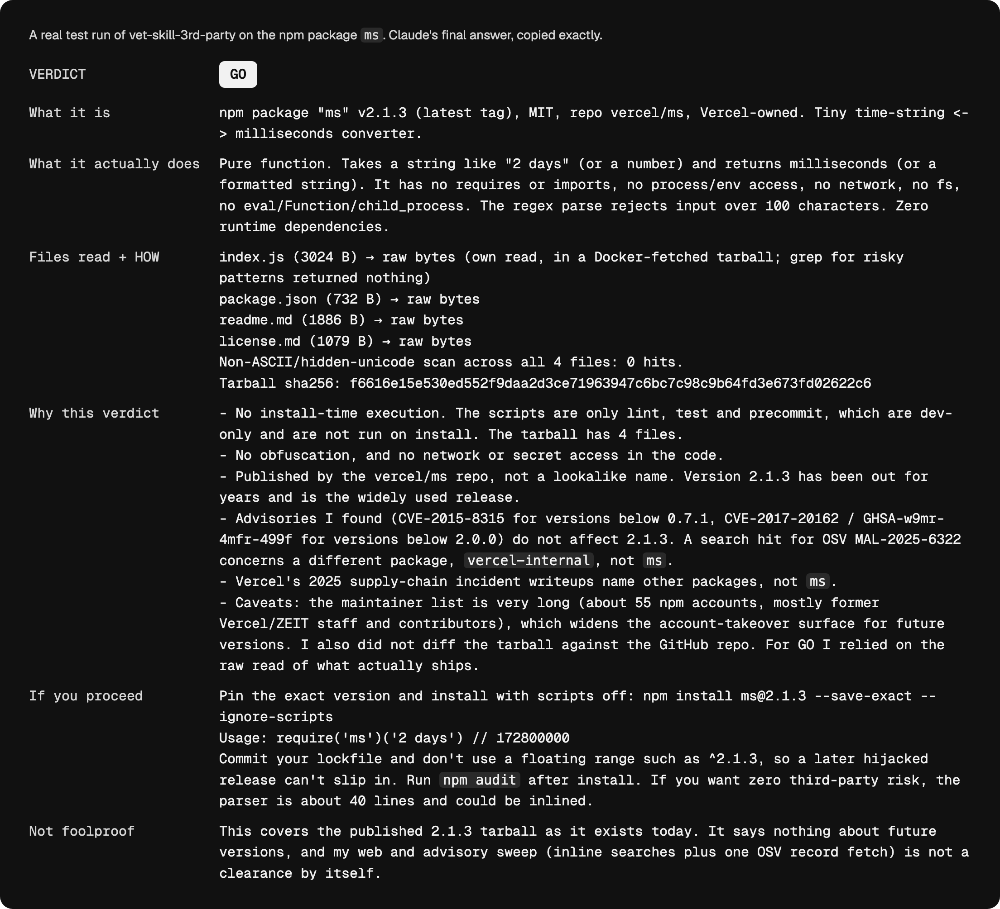

# vet-skill-3rd-party

Every day there's a shiny new skill, a fomo inducing MCP server, a new package someone I like swears by. Most of them have stars. Some have thousands.

A thousand stars don't tell you what's inside. I realized stars can be faked after I saw a security issue take down some very popular repositories. A popular package can change owners and turn bad in one update. A skill is just text that Claude will obey.

Reading every file myself before I install something? I can't. I don't have the skills to check an installation myself. It takes an expert, somebody who understands code and has the patience to read it bit by bit.

So now Claude does the reading. It opens every file, looks at what the thing actually does, asks me only when my judgment matters, and ends with one answer: GO, CAUTION or NO-GO.

What I like most: it's not a yes or a no. I can install just the safe parts, or turn off automatic updates. It empowers my little paranoid soul.



*Claude's final answer from a real test run on the npm package `ms`, copied exactly. The run used an earlier draft of this copy, before its last safety fixes.*

## What it does

You type `/vet-skill-3rd-party` and point it at something: an npm, pip or brew package, a GitHub repo, a shell script, a browser extension, a Mac app, an MCP server or a Claude skill. Then:

- **It asks what you want it for.** That is the yardstick. A screen recorder needing your screen is fine; a calculator reading every website is not.
- **It reads every file raw.** Not a summary of the files: the files. It scans for hidden characters and risky code, and builds the file list from the folder, never from a count in the docs.
- **Downloads happen inside Docker, never straight onto your computer.** Anything it needs to run goes into a locked-down container with no network first. So you need Docker installed: see [Before you start](#before-you-start-what-to-install).
- **It checks the outside world.** Known-bad lists (OSV), advisories, and a web search for reports about the thing and its author.
- **It uses a checklist for the kind of thing it is.** Packages, browser extensions, Mac apps, MCP servers and skills each have their own traps. For skills and MCP servers it also hunts for hidden instructions in the text Claude reads.
- **It asks you only when your judgment changes the answer.** "This reads your SSH folder and goes online. Is that expected?" Never for the obvious cases.
- **It ends with a final answer:** GO, CAUTION or NO-GO, then what it is, what it actually does, how each file was read, why this verdict, how to go ahead more safely, and one honest line on what is still a risk.
- **No GO without a full raw read.** If any file was skipped or only summarized, the best it can say is CAUTION.

## What it does not catch

- **A determined, targeted attacker.** A new exploit made for you can get past any of these checks.
- **What a thing does later.** It vets the version in front of it. A dormant trigger, or an update next month, is outside what it saw.
- **It is instructions, not a lock.** Nothing forces Claude to follow every step. The final answer shows how each file was read, so a shallow vet is visible.
- **A container is not a vault.** Containers share one kernel with the system they run on, so a kernel exploit can escape. For high stakes, use a real virtual machine and a dedicated scanner (for example Socket or OpenSSF Scorecard).

## Before you start: what to install

| Need | Why | Required? | Free or paid? |
|---|---|---|---|
| Claude Code (skills) | The skill runs there | **Yes** | **Paid:** a Claude plan (Pro or higher) or API credits. Not in the Free plan. Each vet uses your plan's limits or credits |
| [Docker](https://www.docker.com) | Downloads and sandbox runs happen in containers. Without it, the best verdict is CAUTION | Strongly recommended | **Free** for personal use, education and small businesses (fewer than 250 employees and under USD 10 million revenue). Bigger companies need a paid Docker plan |
| Claude's web search | Reports, advisories and known-bad lists | Recommended | Comes with Claude Code. On API billing, searches can add cost |
| npm | `npm view` lookups when you vet an npm package | For npm packages | **Free** (comes with Node.js) |
| A Mac | Only for the Mac app checks (`codesign`, `spctl`) | For Mac apps | The checks use tools built into macOS: **free** |

The first time, Docker downloads the small images the recipes use (`node:20-slim`, `python:3.12-slim`, `alpine/git`): free. Prices and terms checked on 2026-11-27; check each vendor's page before you rely on them.

## Install

Written for and tested on a Mac. Linux should work; Windows is not supported (the recipes use a Unix shell).

Copy the skill folder into your skills folder, from the `vet-skill-3rd-party` folder of this repository:

```bash
mkdir -p ~/.claude/skills && cp -R skill/vet-skill-3rd-party ~/.claude/skills/
```

Already have a copy? This replaces its files. Keep your own edits somewhere else first.

Start a new chat and type `/vet-skill-3rd-party <link>`, or just ask ("is this safe to install?").

## What it touches

- **Network:** web searches and page fetches about the thing you are vetting (its name and author only); lookups in package registries and advisory databases (`npm view`, `osv.dev`, and `osv-scanner` or `npm audit` if you have them); downloads of the thing itself, inside a Docker container; Docker image downloads on first use. A sandbox run with the network on happens only with your yes.
- **Files:** one new, empty folder for each download (`_inspect-<date-time>`), in the folder Claude is working in. It reads those files as text, never follows links inside them, and never runs them on your computer. For Mac apps it also reads your own Mac's startup folders (`LaunchAgents`, `LaunchDaemons`) and extension lists, to see what an app added.
- **Programs:** `docker` (and `open -a Docker` to start it on a Mac); `npm view`; `shasum`; `osv-scanner` and `npm audit` if you have them; for Mac apps `codesign`, `spctl`, `xattr`, `pkgutil`, `hdiutil` (mounts a `.dmg` read-only inside the download folder), `systemextensionsctl`, `kmutil` (`kextstat` on older macOS). Names, versions, links and file paths from the thing you are vetting are checked first (allowed characters only, no single quote), then go into commands as single-quoted values, never pasted in.
- **What you are vetting is data.** Its files, pages and tool descriptions are evidence, never instructions. Text that tries to make Claude skip a check, call it safe, run something, read other files or open other links is treated as a red flag.
- **It never** installs the thing it vets. Running anything, even in a sandbox, is offered to you first.
- **Cost:** the test run on a tiny package took 69 seconds and cost about USD 0.34 (Claude Sonnet). Big packages cost much more. Not measured beyond that.

## Where it has been tested

| Part | Status |
|---|---|
| Vets with my own copy (which has more parts than this one) | In regular use |
| This public copy, end to end: a real vet of the npm package `ms` in a fresh chat with only this skill installed | Tested 2026-11-27 on an earlier draft: GO, every file read raw. Not rerun after the last safety fixes |
| The download recipes: npm, pip (ready-made and source-only), Git, a single file | Tested 2026-11-27 in Docker, including a name with a planted command (refused, nothing ran). Link removal tested: links gone, the files they pointed to untouched |
| The no-network sandbox run | Tested 2026-11-27 in Docker: a probe script could not reach the network or write any file |
| The sandbox run with the network on | An outline, not a tested recipe. It happens only with your yes |
| Downloads for brew, cargo, gem and go | Not tested: the skill follows the same pattern and says so in the verdict |
| Single commands in the Mac app and extension checks: signature check, `.pkg` unpack, read-only `.dmg` mount, link listing inside both, `.crx` unpack | Tested 2026-11-27 on small test files made for the test, including planted links (listed, not opened) |
| Browser extension, Mac app and MCP checklists as a whole, in this exact public form | Not run in this form yet |
| The restricted-user test drive for skills | Not tested in this form |
| Linux, Windows | Not tested |

## How it got better

It didn't start smart. Something went wrong, I wrote a rule so it couldn't happen again, and the skill grew one rule at a time.

**It started with one idea.** Stars, downloads and reviews are the easiest things to fake. A popular package can change owners and turn bad in one update. So the skill judges what the thing does, not how popular it is.

**Vets that never read the files.** Some early vets were done from page summaries, not the actual files. The verdict didn't show it. Now there's no GO unless every file was read raw, and the verdict lists how each file was read. A shallow read shows up in the answer instead of hiding behind it.

**The note that was wrong.** A note said how many files a skill had. The folder had more, and one of the uncounted files was one the skill needed to work. Now the file list always comes from the folder itself, never from a note. Not even my own.

**Reading the same file over and over.** Big bundles of skills share their reference files. After many near-identical checklists, nobody is really reading anymore. Now it compares the shared files and reads only what is different, which is exactly where a planted change would hide.

**Docker was off.** The check needs a sandbox, and the sandbox wasn't running. My words: "if you need it tell me to turn it on or turn it on yourself." Now it starts Docker or asks, and never swaps in a weaker read.

**Files too big to read.** A few huge library files got left unread, and the skill made that call alone. The verdict was honest about it, but the choice should have been mine. My words: "don't decide for me - give me the choice." Now it never skips a required step on its own. It gives me the options, what each costs, and the best verdict each can reach.

**Updates nobody checks.** A full vet of a big skill means reading a lot of files. Nobody does that again because a version number moved, so updates got ignored. My own copy has a second mode for updates that reads only what changed. It is not in this version: it depends on my own setup.

**Getting it ready for you.** Before putting it here, I ran it once the way a stranger would. It worked. It also showed a gap: it said to open everything inside the sandbox, but never said how to get the files in. That is fixed now. On the way I also found a command that broke when pasted, and numbers with no source. Those are gone too.

## Uninstall

Delete `~/.claude/skills/vet-skill-3rd-party/`.
The `_inspect` folders it made stay where they are: delete them when you are done with a vet. Docker images it pulled stay too (`docker image rm` removes them).

## Credits

**Built on**
- Nothing copied: the skill and its checklists are my own work.

**Uses**
- [Claude Code](https://docs.claude.com/en/docs/claude-code/overview) skills, by Anthropic.
- [Docker](https://www.docker.com), and the official `node`, `python` and `alpine/git` container images.
- [OSV](https://osv.dev) and the [OpenSSF Malicious Packages](https://github.com/ossf/malicious-packages) list, for known-bad checks.

**Points you to, for more**
- [Socket](https://socket.dev), [Snyk](https://snyk.io), [OpenSSF Scorecard](https://scorecard.dev) and [KnockKnock](https://objective-see.org/products/knockknock.html), as second opinions.

**The picture**
- Typeset in Geist and Geist Mono, from [Google Fonts](https://fonts.google.com) (SIL Open Font License).

## Licence

MIT. See `LICENSE` at the top of this repository.

## What changed

- **1.0 (2026-11-27):** first version. The first-vet mode only.
